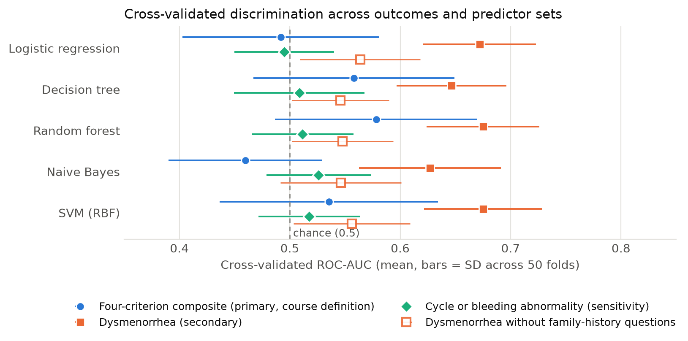

# Menstrual disorders in female university students: a leakage-controlled reanalysis

**An independent reanalysis of a 436-response survey from an epidemiology field-practice course project: descriptive statistics, association analysis and five classifiers, run under a health-ecology framing.**

## Project overview

The original team project, **Analysis of Factors Affecting Menstrual Disorders in Female College Students and the Development of a Risk Prediction Model Based on Health Ecology**, was completed in the Field Practice of Epidemiology module. The team designed a questionnaire covering environmental and social conditions, lifestyle, psychological factors, and individual physiological characteristics, and analysed **436 valid responses**.

The work combined descriptive statistics and between-group comparisons with multivariable logistic regression and four machine-learning classifiers: decision tree, random forest, Naive Bayes, and SVM. This repository builds on that course project with explicit outcome construction and a consistent evaluation workflow; logistic regression is also included as a prediction baseline.

## Reanalysis workflow

1. Rebuild the final four-criterion composite outcome from questionnaire fields, with dysmenorrhea as a secondary outcome and cycle or bleeding abnormality as a sensitivity analysis.
2. Describe the sample and examine associations using univariable tests and exploratory multivariable logistic regression.
3. Compare five classifiers using repeated stratified cross-validation, fitting preprocessing and feature selection only on each training fold.
4. Examine robustness using a **logistic-regression permutation test** and a dysmenorrhea analysis excluding the two family-history questions.

The project illustrates why model evaluation requires attention to data quality, outcome definitions, sample distribution, and the reliability of results, alongside the choice of algorithm.

## Background

The survey was designed and collected by a course team in an epidemiology field-practice module, around a health-ecology framework: upstream environmental, educational, economic, policy, social-support and family factors; midstream psychological, dietary, activity and substance-use factors; downstream individual and family history. The questionnaire, the data and the original analyses belong to that team, and are acknowledged here as team work. **This repository contains my own reanalysis code and results.** [`docs/variable_dictionary.csv`](docs/variable_dictionary.csv) maps all 75 predictor fields to those ecological tiers, in English and Chinese.

The original course report used descriptive statistics, group comparisons, multivariable logistic regression and four classifiers (decision tree, random forest, Naive Bayes, SVM). [`docs/original_report_notes.md`](docs/original_report_notes.md) explains how this reanalysis relates to it.

## Outcomes

| Outcome | Definition (any one is enough) | Positive / negative |
| --- | --- | ---: |
| **Four-criterion composite** (primary; the course's final definition) | Cycle length outside 21–35 days; bleeding length outside 3–7 days; PBAC score < 37 or > 150; self-reported dysmenorrhea | 384 / 52 |
| **Dysmenorrhea** (secondary) | Self-reported dysmenorrhea | 269 / 167 |
| Cycle or bleeding abnormality (sensitivity) | The first three criteria only, without dysmenorrhea | 288 / 148 |

These are the course project's operational definitions from questionnaire answers, not clinical diagnoses. The sensitivity analysis asks whether conclusions depend on counting dysmenorrhea. Full details: [`docs/outcome_definitions.md`](docs/outcome_definitions.md).

## Results

**Cross-validated ROC-AUC, mean (SD across 50 folds).** Five-fold stratified cross-validation repeated 10 times; preprocessing, one-hot encoding and top-30 feature selection are fitted on each training fold only. Hyperparameters are fixed, not tuned.

| Model | **Primary:** four-criterion composite | Secondary: dysmenorrhea | Dysmenorrhea without family-history questions | Sensitivity: cycle or bleeding abnormality |
| --- | ---: | ---: | ---: | ---: |
| Logistic regression | 0.49 (0.09) | 0.67 (0.05) | 0.56 (0.05) | 0.49 (0.05) |
| Decision tree | 0.56 (0.09) | 0.65 (0.05) | 0.55 (0.04) | 0.51 (0.06) |
| Random forest | 0.58 (0.09) | 0.68 (0.05) | 0.55 (0.05) | 0.51 (0.05) |
| Naive Bayes | 0.46 (0.07) | 0.63 (0.06) | 0.55 (0.05) | 0.53 (0.05) |
| SVM (RBF) | 0.54 (0.10) | 0.68 (0.05) | 0.56 (0.05) | 0.52 (0.05) |

- **The primary outcome has only 52 negatives**, so its AUCs are imprecise (SD 0.07–0.10 across folds). I report it because it is the course's final definition, and show the dysmenorrhea and 288 / 148 analyses so the result does not rest on one definition.
- **Permutation check of the logistic-regression pipeline only** (200 label shuffles; one five-fold split): primary composite p = 0.54, dysmenorrhea p = 0.005, cycle or bleeding p = 0.25 ([`results/permutation_check.csv`](results/permutation_check.csv)). These p-values do not test the other four classifiers and are distinct from the 50-fold mean AUCs above.
- **Univariable scan** of the 70 predictors that vary (`x57` is constant) per outcome with Benjamini–Hochberg correction: for the primary composite only mother's dysmenorrhea history survives (q = 0.005); for dysmenorrhea it also survives correction (q < 10⁻⁹), with two further items (awareness of insurance policy, `x15`; internet/social media as a source of menstrual-health knowledge, `x9`) at q ≈ 0.04 that should be treated as exploratory; nothing survives for cycle or bleeding.
- **Multivariable logistic regression** (16 terms spanning the ecological tiers; 435 complete cases): mother's dysmenorrhea history is clearly associated with both the primary composite (OR 7.4, 95% CI 2.6–21.3) and dysmenorrhea (OR 6.9, 4.0–11.9); no other term reaches the nominal 0.05 threshold in these models. These adjusted ORs concern covariate adjustment, not the BH correction used in the separate univariable scan. Terms were chosen by me for interpretability, not from a registered plan, and ordinal answers enter as linear trends. The primary-outcome model has only 52 negative cases for 16 predictors plus an intercept, so its estimates may be unstable and remain exploratory. See [`results/`](results/).

## Interpretation and limits

- The data are cross-sectional and self-reported, from a convenience sample at one university: associations only, no causal claims, and prevalence figures (88% for the primary outcome) do not describe any population.
- PBAC, cycle and bleeding lengths are recalled answers. The positive class is large for every outcome, so sensitivity and specificity depend on class weighting; AUC and balanced accuracy are reported in `results/model_comparison.csv`.
- Repeated cross-validation folds are not independent, so the SD across folds is a descriptive spread, not a confidence interval. With 436 respondents none of these AUCs is precise.
- Behaviours reported during menstruation (`x58–x60`, `x63`) are excluded from prediction because they may be consequences of the outcome.
- The evaluated models showed limited discrimination for the composite outcome and near-chance discrimination for cycle or bleeding abnormality in this sample. This does not establish that the outcomes are inherently unpredictable.
- Removing the two family-history questions reduced dysmenorrhea ROC-AUC from approximately 0.63–0.68 to 0.55–0.56. This describes a change in predictive performance, not a causal mechanism or proof that family history is the only relevant factor.
- No statistically significant association with dormitory insecticide use was detected in the three univariable analyses (p = 0.97, 0.89 and 0.18 for the primary, secondary and sensitivity outcomes, respectively). This is not proof of no association.
- These exploratory models are not validated screening tools.



## Reproducing the analysis

The survey workbook is private and **not included**. To check that the code runs, use the synthetic generator, which writes random records in the same layout:

```bash
python3 -m venv .venv
source .venv/bin/activate          # Windows PowerShell: .venv\Scripts\Activate.ps1
python -m pip install -r requirements.txt

python src/make_synthetic_data.py                                   # fake data -> data/
python src/analyze.py       --data data/synthetic_survey.xlsx --out synthetic_results
python src/make_figures.py  --results synthetic_results --figures synthetic_results
```

Synthetic outputs test the software only; they say nothing about the study. With an authorized copy of the workbook, point `--data` at it and write to `results/`. Requires Python 3.12 or later (tested on 3.13). Runtime depends on the machine; the full run includes repeated cross-validation and 200 permutations per outcome.

## Repository layout

| Path | Contents |
| --- | --- |
| `src/analyze.py` | Descriptives, univariable scan, logistic models, repeated-CV classifiers, permutation and ablation checks |
| `src/common.py` | Column mapping, outcome definitions, predictor lists and exclusions |
| `src/make_figures.py`, `src/make_synthetic_data.py` | Figure; fake data for testing |
| `results/` | Aggregate tables only |
| `docs/` | Outcome definitions, data notes, notes on the original report, bilingual variable dictionary, two-page brief |

## Data statement

No individual-level data, free-text answers or identifiers are in this repository. The course design documents describe anonymous, voluntary participation with no names or student numbers collected. Outputs are aggregate tables and figures. Source code is released under the MIT License.
